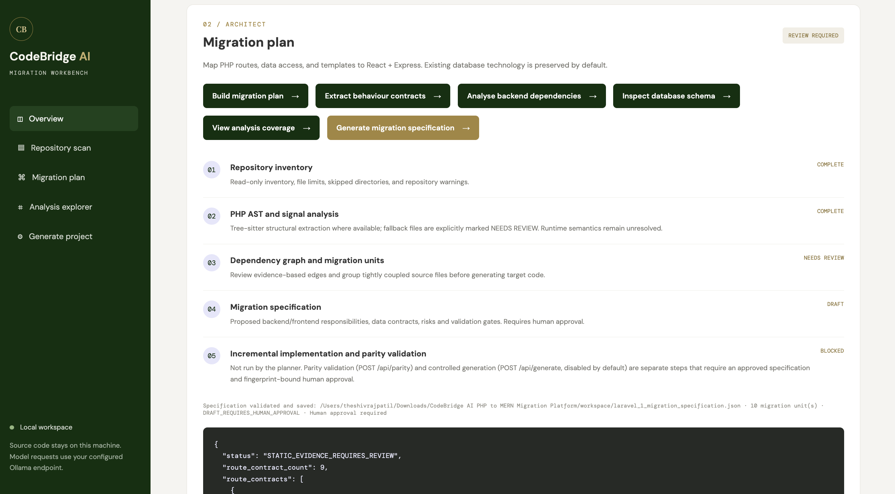
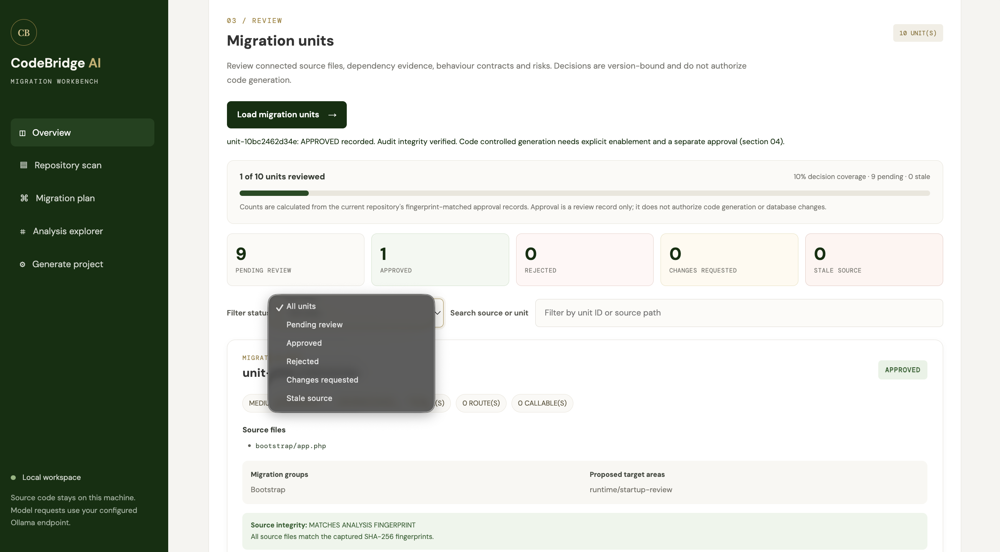
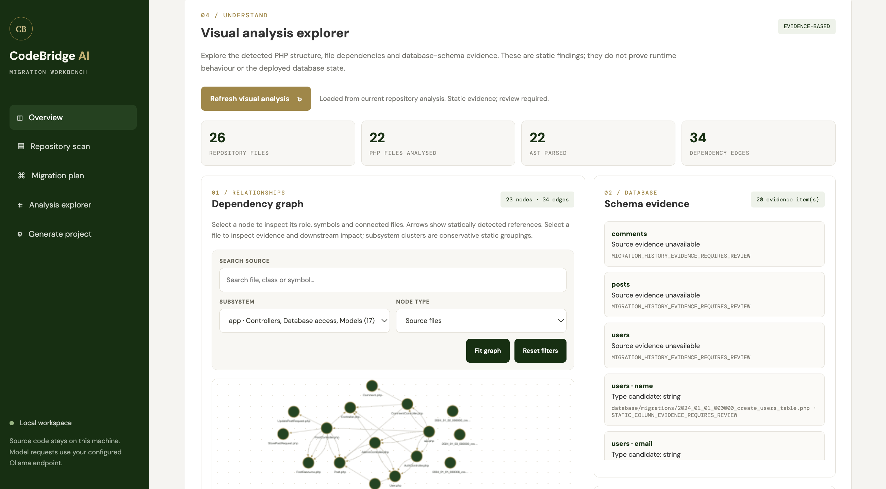
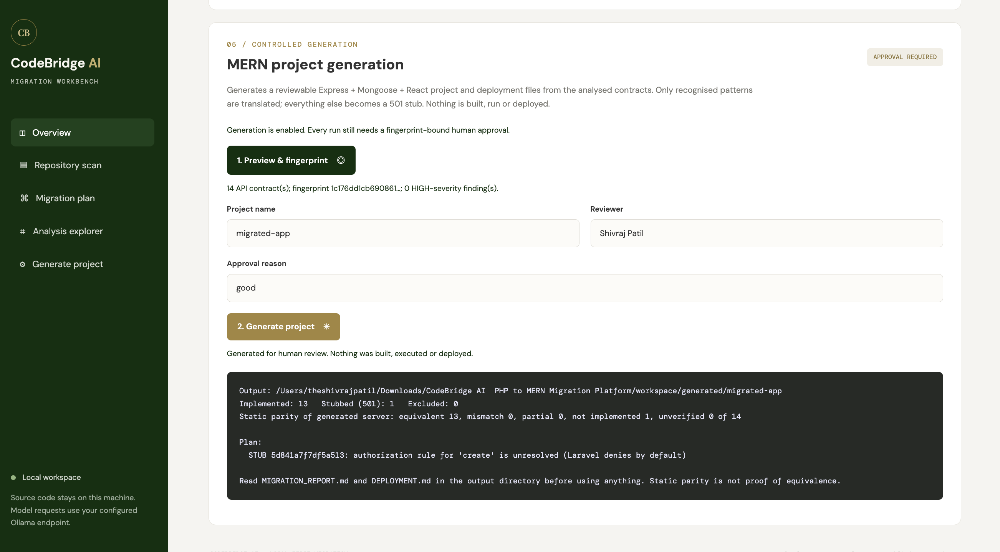
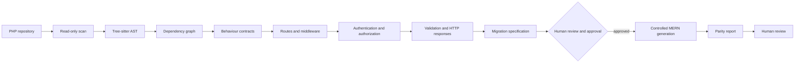

# CodeBridge AI

**Evidence-based, human-approved migration of PHP applications to a MERN stack.**


CodeBridge AI is a local-first migration workbench. It analyses a PHP codebase statically (nothing is executed),
extracts what the application actually does, lets a reviewer approve a migration plan, and can then generate an
Express, Mongoose and React project. A deterministic parity engine re-analyses the generated code and compares it with
the original, reporting every match, mismatch and unknown.


## Highlights

- **Static analysis, no execution.** PHP is parsed with Tree-sitter. Source files are never run or modified.
- **Evidence for every finding.** Routes, middleware, authentication, authorization, validation, responses and database
  operations are reported with source file, line and confidence.
- **Human approval required.** Decisions are bound to the exact source version and recorded in a hash-chained audit log.
- **Verified output.** Generated code is compared against the PHP source across status codes, validation, authorization
  and database operations. Unproven behaviour is reported as unresolved, never as equivalent.
- **Local-first.** Source code stays on your machine. A language model is optional and only explains findings.

## Results on the included example

| Measure | Result |
|---|---|
| PHP files analysed | 22 |
| Dependency graph | 23 nodes, 34 edges |
| Routes extracted (with middleware and groups) | 15 |
| Behaviour contracts extracted | 12 |
| API contracts available for generation | 14 |
| Generated contracts statically verified equivalent | 13 of 14 (92.9 percent) |
| Individual parity checks run | 105 |
| Mismatches caught in a deliberately flawed target | 4 of 4 mapped contracts |
| Files in the generated project (server, client, Docker, CI) | 52 |
| REST endpoints in the backend | 27 |
| Automated test cases | 133 |

How to read these numbers:

- "Verified equivalent" means every compared item agreed under static analysis. It is evidence for a reviewer, not proof
  of identical runtime behaviour.
- Anything that cannot be proven is reported as unresolved and is never counted as a match.
- Runtime comparison needs an isolated sandbox that is not bundled. The report states that no runtime tests were run.
- Measured on the bundled example (`examples/laravel_blog_fixture`) and its generated project.
  Results on other codebases will differ.

## Screenshots

### Migration plan

Stage-by-stage plan from inventory to specification. Stages the planner does not run are shown as blocked, not faked.



### Migration unit review

Every migration unit is reviewed by a person. Approval is recorded per exact source version and does not authorize code
generation by itself.



### Visual analysis explorer

Interactive dependency graph and database-schema evidence (23 nodes, 34 edges, 20 evidence items for the example).
Everything shown is static evidence and is labelled as such.



### Controlled generation

Generation shows a fingerprint of the exact source, needs a reviewer and reason, and reports static parity of the
output. Here: 13 contracts implemented, 1 stubbed, 13 of 14 equivalent. Nothing is built, run or deployed.



## How it works



Each contract in the parity report receives one of six statuses: `VERIFIED_EQUIVALENT`, `VERIFIED_MISMATCH`,
`PARTIALLY_VERIFIED`, `NOT_IMPLEMENTED`, `UNVERIFIED` or `BLOCKED`.

## Quick start

Requires Python 3.10 or newer.

**macOS / Linux**

```bash
./run.sh
```

This creates a `.venv`, installs `requirements.txt` and starts the server.

**Manual setup (all platforms)**

```bash
python3 -m venv .venv
source .venv/bin/activate            # Windows: .venv\Scripts\activate
pip install -r requirements.txt
python -m uvicorn app.main:app --host 127.0.0.1 --port 8000
```

Open http://127.0.0.1:8000. Interactive API documentation is at http://127.0.0.1:8000/docs.

The server has no login. Keep it bound to `127.0.0.1`.

### Typical workflow

1. **Scan.** Enter the absolute path of a PHP project. Try `examples/laravel_blog_fixture` first.
2. **Plan.** Build the migration plan, extract contracts and generate the migration specification.
3. **Review.** Load the migration units and record a decision for each one.
4. **Explore.** Inspect the dependency graph and schema evidence in the analysis explorer.
5. **Generate.** Preview the source fingerprint, enter a reviewer and reason, and generate (see below).

## Enabling code generation

Generation is locked by default and needs two local switches. Both files are ignored by Git, so a fresh clone stays
locked until you opt in:

| Switch | Location |
|---|---|
| `"generation_enabled": true` | `config/models.local.json` |
| `CODEBRIDGE_GENERATION_ENABLED=1` | `.env` |

The simplest way to set both:

```bash
python scripts/enable_generation.py              # enable
python scripts/enable_generation.py --disable    # lock again
```

Restart the server afterwards. The server prints its generation state at startup, and the page names any switch that is
still missing. Every run additionally requires a fingerprint-bound human approval.

Generated files are written only to `workspace/generated/<project name>`. CodeBridge never installs, builds or deploys
them. Review `MIGRATION_REPORT.md` and `DEPLOYMENT.md` in the output before using anything.

## API overview

| Area | Endpoints |
|---|---|
| Discovery | `POST /api/scan`, `POST /api/analyze`, `GET /api/state` |
| Analysis | `POST /api/behavior`, `POST /api/dependencies`, `POST /api/schema`, `GET /api/coverage`, `POST /api/impact` |
| Intelligence stages | `POST /api/intelligence/{stage}` where stage is `dependency-graph`, `contracts`, `routes`, `auth` or `validation-response` |
| Planning | `POST /api/plan`, `POST /api/specification` |
| Review | `GET /api/migration-units`, `GET /api/migration-units/{id}`, `POST /api/migration-units/{id}/decision`, `GET /api/migration-approvals/audit` |
| Parity | `POST /api/parity` |
| Generation | `GET /api/generate/status`, `POST /api/generate/preview`, `POST /api/generate` |
| Agents and models | `/api/agent-system/*`, `GET /api/models`, `GET /api/health` |

## Configuration

| File | Purpose |
|---|---|
| `config/models.json` | Model provider and routing. Ships with generation disabled. |
| `config/models.local.json` | Local generation opt-in (git-ignored) |
| `.env` | Local environment settings (git-ignored). Copy `.env.example` as a starting point. |

The default model provider is a local [Ollama](https://ollama.com) endpoint. Analysis, parity and generation do not
need a model. Cloud provider API keys, if used, are read from environment variables only.

## Testing

```bash
python -m unittest discover -s tests -v
```

The suite has 133 test cases in 14 modules. They cover the scanner, PHP parsing, every analysis stage, approvals and the
audit log, generation safety checks (path traversal, symlinks, injection-safe emission, stale approvals) and each parity
status. In a reference run without the optional FastAPI and tree-sitter packages installed, 127 of the 132 executable
tests passed, 5 were skipped and none failed. Install `requirements.txt` to run the complete suite.

## Project structure

```
app/                  FastAPI backend and analysis engines
  dependency_graph.py   dependency graph
  contract_extraction.py behaviour contracts
  routes_intelligence.py routes and middleware
  auth_intelligence.py  authentication and authorization
  validation_response.py validation and HTTP responses
  parity_engine.py      behavioural parity engine
  target_analysis.py    static analysis of MERN targets
  mern_generator.py     controlled generation
  migration_units.py    review units, approvals, audit chain
  agents/, providers/   optional model routing
frontend/             Web interface
config/               Model and feature settings
examples/             PHP example, MERN target example, generated sample
scripts/              Helper scripts
tests/                Automated tests
docs/screenshots/     Interface screenshots
workspace/            Runtime output (git-ignored)
```

## Security model

- PHP is never executed. Generated JavaScript is never installed, built or started by CodeBridge.
- Generation needs two local switches plus a fingerprint-bound human approval on every run.
- Approval decisions are stored with locked persistence and a hash-chained audit log.
- Output is confined to `workspace/generated/<name>` with path-traversal, symlink, overwrite and size checks.
- PHP-derived identifiers are validated and all strings are emitted as JSON literals.
- Secrets are read from environment variables, redacted from reports and excluded from Git.
- A language model can explain a finding but never decides correctness or approves a migration.
- High-risk findings (for example unauthenticated state changes) need an explicit reviewer acknowledgement.

## Limitations

- Analysis is static, so dynamic dispatch and runtime configuration can remain unresolved.
- Route, middleware and authorization analysis is deepest for Laravel. Other PHP frameworks get lower-confidence,
  convention-based results.
- Views, jobs, mail, events, file uploads, many-to-many relations and complex business logic are stubbed or reported
  instead of translated.
- Business-rule comparison is structural. Equivalent logic written differently is reported as unresolved.
- Runtime differential testing is not bundled. Without a sandbox it is reported as unavailable.
- Generated projects are analysed but not built or run by CodeBridge. Test and review them in an isolated environment.