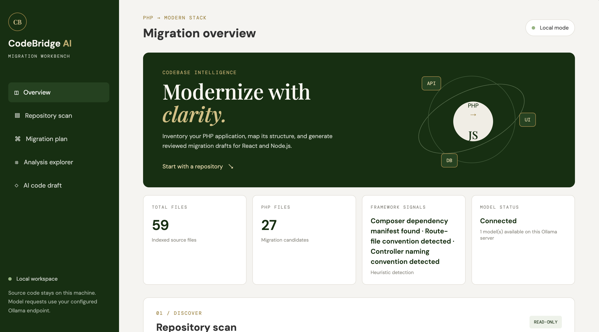
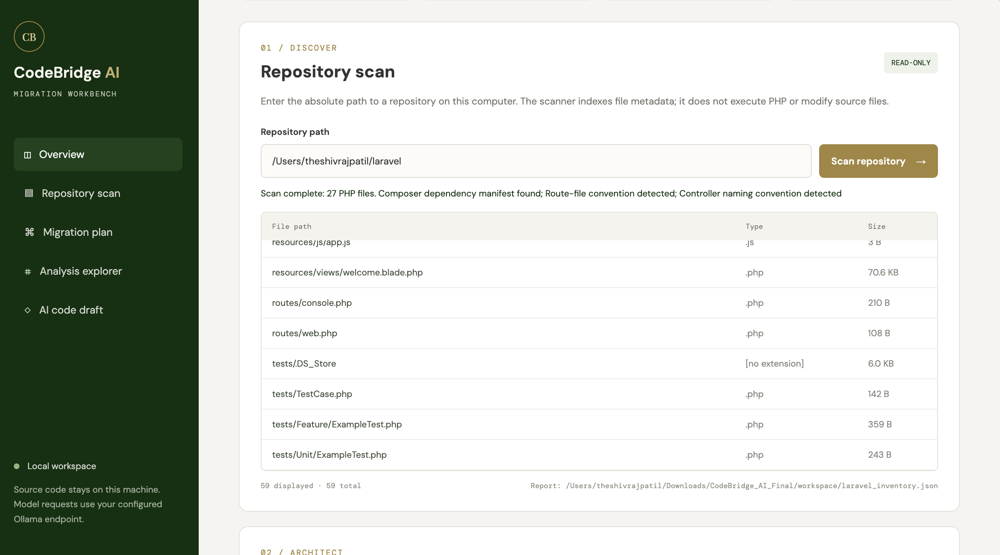
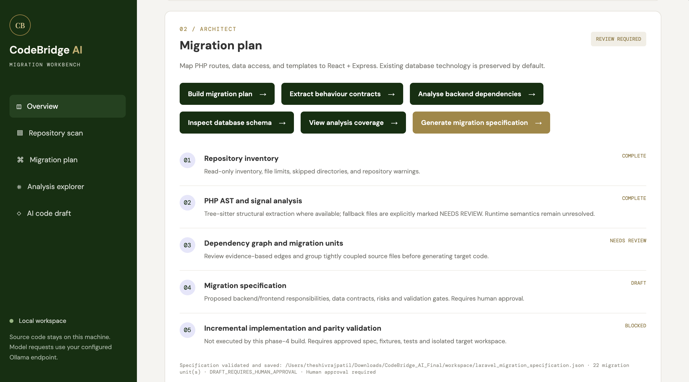
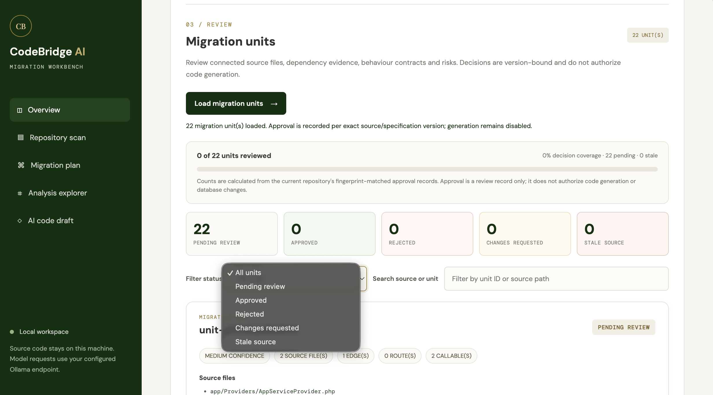

# CodeBridge AI

A local tool that helps migrate a PHP/Laravel application to a MERN stack (MongoDB, Express, React, Node.js).

It reads your PHP code without running it, works out what each route does (authentication, authorization,
validation, responses, database use), lets you review and approve the plan, and can then generate an Express and
React project. A built-in checker compares the generated code against the original PHP behaviour and reports every
difference it finds.



## What it does

1. **Scan** a PHP repository (read-only, nothing is executed).
2. **Analyse** the code: dependency graph, behaviour contracts, routes and middleware, authentication and
   authorization, validation and HTTP responses.
3. **Plan** the migration and review each migration unit. Approvals are recorded against the exact source version.
4. **Generate** an Express and React project (off by default, requires approval).
5. **Check parity**: compare the original and the new code and report matches, mismatches and anything it cannot
   verify.

## Results on the included example

| Measure | Result |
|---|---|
| Routes found in the Laravel example | 15 |
| Behaviour contracts extracted | 12 |
| Dependency graph | 22 nodes, 28 edges |
| Generated project checked against the PHP source | 13 of 14 contracts match, 1 not implemented |
| Individual checks run on that comparison | 105 |
| Deliberately wrong Express example | 4 mismatches detected |
| Automated tests | 133 |

Notes on these numbers:

- "Match" means every compared item (status codes, validation, authorization, database operations and so on) agreed
  by static analysis. It is evidence for a reviewer, not a guarantee of identical behaviour.
- Anything the tool cannot prove is reported as unresolved. It is never counted as a match.
- Runtime comparison tests are not bundled. The report states that none were run.
- In a test run without FastAPI and tree-sitter installed, 127 of 132 runnable tests passed and 5 were skipped. Run
  the full suite on your machine (see below) for the complete result.

## Screenshots

**Repository scan**



**Migration plan**



**Migration unit review**



## Quick start

Requires Python 3.10 or newer. On macOS or Linux, one command creates the environment, installs the requirements and
starts the app:

```bash
./run.sh --enable-generation
```

The flag only matters if generation is not already enabled (see below). Then open http://127.0.0.1:8000. API docs are
at http://127.0.0.1:8000/docs.

Manual setup (also for Windows):

```bash
python3 -m venv .venv
source .venv/bin/activate          # Windows: .venv\Scripts\activate
pip install -r requirements.txt
python -m uvicorn app.main:app --host 127.0.0.1 --port 8000
```

Keep the server on `127.0.0.1`. It has no login and should not be exposed to a network.

## Enabling code generation

Generation is protected by two switches, and both must be on:

1. `"generation_enabled": true` in the local file `config/models.local.json`. The tracked `config/models.json` ships with
   it set to `false`.
2. The environment variable `CODEBRIDGE_GENERATION_ENABLED=1`, normally kept in a local `.env` file.

Both local files are ignored by Git, so a fresh clone from GitHub has generation off until you opt in. If your download
already contains `.env` and `config/models.local.json`, generation is already on. Otherwise run:

```bash
python scripts/enable_generation.py
```

and restart the server. To lock it again, run `python scripts/enable_generation.py --disable`. When the server starts it
prints one line showing whether generation is enabled, and the page tells you exactly which switch is missing.

Then:

1. Scan a Laravel project that has API routes (routes/api.php). Web-only routes such as Blade pages are not generated.
   The included `examples/laravel_blog_fixture` is a good first try.
2. Build the plan and specification, click "Preview & fingerprint", enter a reviewer and reason, and generate.

Generated files are written only to `workspace/generated/<name>`. CodeBridge never installs, builds or deploys them.
Approval is tied to the exact source version, so changing the source requires a new approval.

Typing `CODEBRIDGE_GENERATION_ENABLED=1` on a line by itself does not pass the variable to the server. Use the `.env`
file, `export`, or put it before the command on the same line.

## Safety

- PHP is never executed and your source files are never modified.
- Generated code is never run or deployed by the tool.
- Generation needs two switches (config and environment variable) plus human approval.
- Approval decisions are stored in a tamper-evident audit log.
- A language model, if you configure one, can only explain findings. It never decides correctness or approves anything.
- Source code stays on your machine.

## Optional: local language model

The analysis does not need a model. To use one, install [Ollama](https://ollama.com), then run
`ollama pull qwen2.5-coder:3b` and `ollama serve`. Provider settings are in `config/models.json`. Copy
`.env.example` to `.env` for API keys if you use a cloud provider. Never commit `.env`.

## Tests

Run these inside the virtual environment where you installed `requirements.txt` (otherwise the FastAPI and
`requests` tests cannot import).

```bash
source .venv/bin/activate
pip install -r requirements.txt
python -m unittest discover -s tests -v
```

133 tests cover the scanner, PHP parsing, each analysis stage, approvals and audit log, generation safety checks and
the parity checker.

## Project layout

```
app/          Backend (FastAPI) and analysis engines
frontend/     Web interface
config/       Model and feature settings
examples/     Laravel example, Express example, generated sample project
tests/        Automated tests
docs/         Screenshots
workspace/    Local output (ignored by Git)
```

## Limitations

- The analysis is static, so dynamic PHP behaviour can remain unresolved.
- Support is focused on Laravel.
- Views, jobs, mail, events, file uploads, many-to-many relations and complex business logic are stubbed or reported
  rather than translated.
- Review and test generated projects in an isolated environment before using them.
